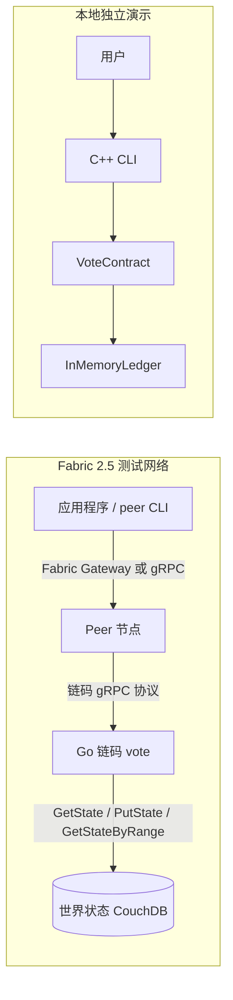
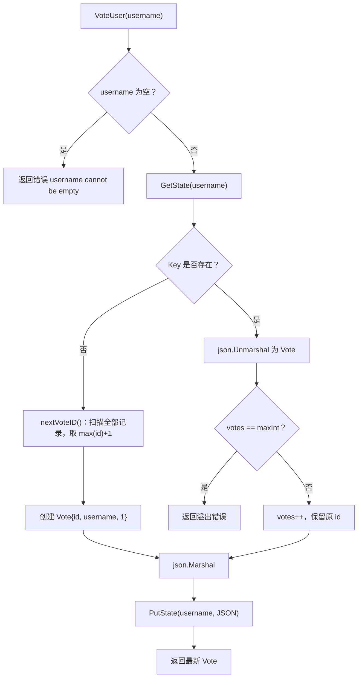
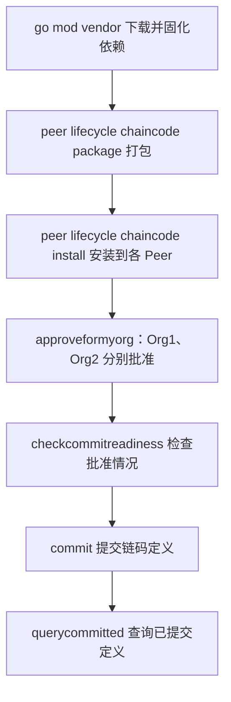
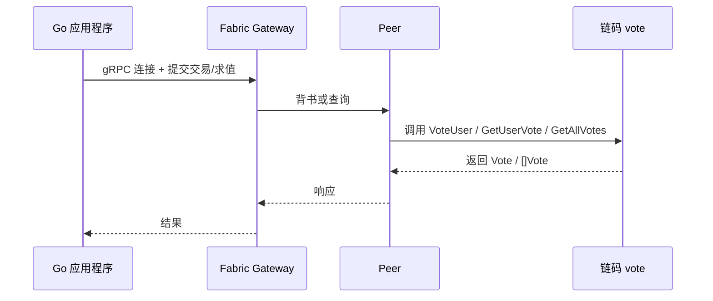

# 投票智能合约实现文档

> 课程：华中科技大学《区块链技术及应用》
> 平台：Hyperledger Fabric 2.5.4
> 合约名：`vote`
> 仓库内容：Go 可部署链码 + C++17 等价实现

---

## 1. 概述

本实验在 Hyperledger Fabric 2.5 测试网络上开发、部署并调用一个投票智能合约。合约维护每个被投票人的得票数，支持投票、查询单个用户和查询全部用户三种交易。

仓库提供两套实现：

| 实现 | 位置 | 用途 | 能否部署到 Fabric |
| --- | --- | --- | --- |
| Go 链码 | 根目录 `main.go`、`chaincode/` | 完成实验要求的部署、命令行调用、应用程序调用 | 能，`deployCC -ccl go` |
| C++ 独立实现 | `cpp/` | 回答手册 4.4 选做题“用其他编程语言实现该合约” | 不能，见第 10 节 |

两套实现使用完全相同的资产模型、交易名称、参数、JSON 格式和错误语义，可以对照阅读。

### 1.1 设计目标

1. **行为等价**：对外交易名称、参数、返回值、JSON 字段与实验参考实现一致。
2. **确定性**：链码执行结果只依赖世界状态，不依赖进程内可变状态。
3. **可验证**：C++ 版本提供自动化测试；Go 版本提供命令行验证步骤。
4. **可读性**：源代码包含详细中文注释，文档用流程图和伪代码说明关键逻辑。

---

## 2. 需求分析

### 2.1 资产定义

```text
Vote(id, username, votes)
```

表示 `username` 获得了 `votes` 票。

| 字段 | 类型 | JSON 键 | 说明 |
| --- | --- | --- | --- |
| `id` | 整数 | `id` | 资产编号；新用户第一次被投票时分配 |
| `username` | 字符串 | `username` | 被投票人；同时作为世界状态的 Key |
| `votes` | 整数 | `votes` | 当前得票数 |

### 2.2 交易规则

| 交易 | 参数 | 前置条件 | 行为 | 失败情况 |
| --- | --- | --- | --- | --- |
| `VoteUser` | `username` | 用户名非空 | 已存在则票数加一；不存在则创建并置为 1 票 | 用户名为空、读写账本失败、JSON 损坏、数值溢出 |
| `GetUserVote` | `username` | 用户必须存在 | 返回该用户的 `Vote` | 用户不存在、读账本失败、JSON 损坏 |
| `GetAllVotes` | 无 | 无 | 返回全部 `Vote`，按用户名排序 | 读账本失败、JSON 损坏 |
| `InitLedger` | 无 | 无 | 保留的初始化入口，本实现为空操作 | 无 |

`GetUserVote` 在用户不存在时返回的错误消息为：

```text
the UserVote <username> does not exist
```

与参考实现保持一致，便于命令行和应用程序按相同方式处理。

### 2.3 世界状态模型

Fabric 的世界状态是键值数据库，链码通过 `GetState` / `PutState` / `GetStateByRange` 访问。本合约的映射为：

```text
Key   = username
Value = JSON(Vote)
```

示例：

```text
alice -> {"id":0,"username":"alice","votes":2}
bob   -> {"id":1,"username":"bob","votes":1}
```

把用户名直接作为 Key 有两个好处：

1. 查询单个用户是 O(1) 的直接键查询；
2. 不会出现“同一用户多条记录”的重复资产问题。

### 2.4 非功能约束

- **确定性**：不使用进程内全局可变状态，编号从账本推导。
- **零第三方依赖（C++）**：JSON 编解码自行实现，避免离线环境无法拉取依赖。
- **UTF-8**：源代码、账本值、终端输出统一使用 UTF-8。
- **资源管理**：查询迭代器必须关闭。

---

## 3. 总体架构



两条路径共用同一套合约语义：

- **Go 路径**：Peer 负责交易背书、排序、提交；链码只读写世界状态。
- **C++ 路径**：用 `Ledger` 抽象模拟 `ChaincodeStubInterface`，用 `std::map` 模拟世界状态，用命令行模拟交易调用。

---

## 4. Go 链码实现

> 本节给出 Go 实现的概要。核心代码讲解、合约注册机制、读写集/MVCC、确定性与并发分析见 [Go 核心代码说明](Go核心代码说明.md)。

### 4.1 文件与职责

| 文件 | 职责 |
| --- | --- |
| `go.mod` / `go.sum` | 模块定义与依赖校验和；模块名为 `vote` |
| `main.go` | 注册 `SmartContract` 并启动链码 gRPC 服务 |
| `chaincode/smartcontract.go` | 资产模型与全部交易方法 |

### 4.2 启动流程

```text
main()
  ├─ contractapi.NewChaincode(&SmartContract{})
  │    └─ 扫描所有导出方法，生成合约元数据
  └─ chaincode.Start()
       └─ 连接 Peer，注册链码，等待 Invoke / Query
```

链码进程由 Peer 启动（默认运行在 Docker 容器中），业务方法通过 `contractapi.TransactionContextInterface` 获取交易上下文和 Stub。

### 4.3 数据模型

`Vote` 结构体的 `json` tag 决定了账本值和返回值中的字段名：

```text
Vote { Id int `json:"id"`, Username string `json:"username"`, Votes int `json:"votes"` }
```

字段顺序固定为 `id`、`username`、`votes`，两套实现保持一致。

### 4.4 `VoteUser` 流程



伪代码：

```text
function VoteUser(username):
    if username is empty:
        return error

    raw <- GetState(username)

    if raw is null:
        id  <- nextVoteID()
        vote <- Vote{id, username, 1}
    else:
        vote <- Decode(raw)
        vote.votes <- vote.votes + 1

    PutState(username, Encode(vote))
    return vote
```

关键点：

1. **只有新用户才分配编号**，已有用户投票不会改变 `id`。
2. **先读后写**：读取、修改、写回的顺序与 Fabric 的 MVCC 语义一致。
3. **失败不落盘**：只有全部校验和编码成功后才会调用 `PutState`。

### 4.5 `GetUserVote` 与 `GetAllVotes`

`GetUserVote`：

```text
raw <- GetState(username)
if raw is null:
    return error "the UserVote <username> does not exist"
return Decode(raw)
```

`GetAllVotes`：

```text
iter <- GetStateByRange("", "")     // 扫描整个键空间
defer iter.Close()                  // 必须关闭迭代器
for each key/value in iter:
    votes.append(Decode(value))
return votes
```

排序说明：Fabric 按 Key 的字典序返回范围查询结果。对于实验使用的 ASCII 用户名，这与 UTF-8 字节序一致；因此 `GetAllVotes` 的输出按 `username` 升序排列。

### 4.6 为什么不用全局 `NextId`

实验参考实现使用：

```text
var NextId int
```

作为编号计数器。这在 Fabric 中有两个问题：

1. **容器重启后归零**：`NextId` 只存在于链码进程内存中，不进入世界状态。链码容器重建后计数器从 0 开始，新用户可能与账本中已有记录编号重复。
2. **背书节点可能不一致**：Fabric 交易由多个背书节点分别执行。内存状态取决于各节点此前执行过哪些交易，可能产生不同的执行结果，破坏链码的确定性要求。

本实现改为 `nextVoteID()`：扫描当前世界状态，取 `max(id) + 1`。编号完全由已提交的账本状态决定，天然确定，且不需要额外引入计数器键。

代价：每次创建新用户需要 O(n) 扫描。本实验数据规模很小，可以接受；如果用户量很大，可以改用“保留键 + 计数器”，但那样 `GetAllVotes` 必须过滤保留键，并且所有新用户交易都会竞争同一个键，带来 MVCC 冲突。

### 4.7 错误处理与资源管理

- 所有账本读写错误都包装后返回，保留原始原因。
- JSON 反序列化失败视为账本数据损坏，返回错误而不是静默跳过。
- `GetAllVotes` 与 `nextVoteID` 都使用 `defer iter.Close()`。
- 票数与编号自增前检查 `maxInt`，避免整数溢出。

---

## 5. C++ 实现

### 5.1 分层与文件

| 文件 | 职责 |
| --- | --- |
| `cpp/include/vote.hpp`、`cpp/src/vote.cpp` | `Vote` 资产、JSON 编解码、`JsonError` |
| `cpp/include/ledger.hpp`、`cpp/src/ledger.cpp` | `Ledger` 抽象接口与 `InMemoryLedger` |
| `cpp/include/contract.hpp`、`cpp/src/contract.cpp` | `VoteContract`、异常类型 |
| `cpp/include/cli.hpp`、`cpp/src/cli.cpp` | 交互式菜单与输出 |
| `cpp/src/main.cpp` | UTF-8 控制台初始化、对象装配、顶层异常处理 |
| `cpp/tests/test_main.cpp` | 断言式测试 |
| `cpp/CMakeLists.txt` | 构建 `vote_core`、`vote_app`、`vote_tests` 并注册 CTest |

依赖方向：

```text
main / cli  ->  contract  ->  ledger
                    |
                    v
                   vote（JSON 编解码）
```

`VoteContract` 只依赖 `Ledger` 抽象，不依赖具体存储，因此后续可以替换为真实 Fabric Stub 适配层。

### 5.2 JSON 编解码

账本值与 Go `json.Marshal` 的输出保持一致：

```json
{"id":0,"username":"alice","votes":1}
```

编码规则：

- 紧凑格式，无空格，无换行；
- 字段顺序固定为 `id`、`username`、`votes`；
- 用户名按 Go `encoding/json` 的默认规则转义：
  - `"` → `\"`，`\` → `\\`；
  - 换行、回车、制表、退格、换页 → `\n`、`\r`、`\t`、`\b`、`\f`；
  - 其他控制字符 → `\u00XX`；
  - `<`、`>`、`&` → `\u003c`、`\u003e`、`\u0026`（Go 默认 HTML 转义）；
  - U+2028 / U+2029 → `\u2028` / `\u2029`；
  - 其余合法 UTF-8（包括中文）原样输出。

解析器是一个“带 schema 的 JSON 读取器”，不追求通用性，但覆盖账本值所需的能力：

- 接受任意字段顺序和字段间空白；
- 未知字段按 JSON 语法跳过；
- 已知字段重复出现时，后出现的值覆盖先出现的值；
- 字段缺失时保持默认值（`id=0`、`votes=0`、`username=""`）；
- `id`、`votes` 必须是能放入 `int` 的十进制整数，拒绝小数、指数、前导零和溢出；
- 字符串支持 `\"`、`\\`、`\/`、`\b`、`\f`、`\n`、`\r`、`\t`、`\uXXXX` 以及代理对；
- 拒绝未闭合字符串、非法转义、未转义控制字符、错误类型和尾随垃圾；
- 错误以 `JsonError` 抛出，并携带出错字节偏移，便于定位损坏的账本值。

### 5.3 账本抽象

`Ledger` 接口对应 Fabric Stub 的三个方法：

| Ledger | Fabric `ChaincodeStubInterface` | 说明 |
| --- | --- | --- |
| `getState(key)` | `GetState(key)` | 返回 `std::optional<std::string>`；`nullopt` 等价于 Go 的 `nil` |
| `putState(key, value)` | `PutState(key, value)` | 写入或覆盖 |
| `getStateByRange(start, end)` | `GetStateByRange(start, end)` | 返回快照 `vector`，便于管理生命周期 |

`InMemoryLedger` 使用 `std::map<std::string, std::string>`：

- 选择 `std::map` 而不是 `unordered_map`，保证遍历顺序确定，与 Fabric 范围查询的字典序语义一致；
- 范围语义：`startKey` 包含、`endKey` 不包含；空 `startKey` 表示从头开始，空 `endKey` 表示到末尾；两者都为空表示全部；
- 当 `startKey > endKey` 时直接返回空结果，避免迭代器越过末尾。

### 5.4 `VoteContract`

| 方法 | 对应 Go | 说明 |
| --- | --- | --- |
| `initLedger()` | `InitLedger` | 空操作，保留接口 |
| `voteUser(username)` | `VoteUser` | 新用户分配 `max(id)+1`，已有用户票数加一 |
| `getUserVote(username)` | `GetUserVote` | 不存在时抛 `UserNotFoundError` |
| `getAllVotes()` | `GetAllVotes` | 返回按用户名排序的全部记录 |

算法与 Go 版本逐行对应：先 `getState`，不存在则扫描账本推导编号并创建，存在则解码后加一，最后编码写回。

### 5.5 命令行界面

```text
========== 投票智能合约 ==========
1. 投票
2. 查询用户投票
3. 查询全部投票
4. 退出
请选择操作 [1-4]:
```

输入处理：

- 使用 `std::getline` 读取整行，避免 `>>` 与 `getline` 混用；
- 去掉 Windows 换行残留的 `\r` 和首尾空白；
- 空用户名、非法菜单项只提示错误并重新显示菜单，不退出程序；
- 用户不存在时捕获 `UserNotFoundError`，打印中文提示；
- 输入流结束（EOF）时正常退出。

查询全部的输出一行一个 JSON 对象，避免中英文混排导致表格错位：

```text
共 2 条投票记录（按用户名排序）：
{"id":0,"username":"alice","votes":2}
{"id":1,"username":"bob","votes":1}
```

### 5.6 异常模型

```text
std::runtime_error
  └─ VoteError                 所有合约/序列化错误的基类
       ├─ JsonError            携带字节偏移
       └─ ContractError
            └─ UserNotFoundError  携带缺失的用户名
```

- 单个命令失败只打印错误并继续菜单；
- 未预期的异常由 `main` 捕获，打印 `运行错误：...` 并返回 1；
- 正常退出和 EOF 返回 0。

### 5.7 跨平台与 UTF-8

- Windows 下 `main` 调用 `SetConsoleOutputCP(CP_UTF8)` 和 `SetConsoleCP(CP_UTF8)`；
- GCC/MinGW 使用 `-finput-charset=UTF-8 -fexec-charset=UTF-8`；
- MSVC 使用 `/utf-8`；
- 源代码保存为 UTF-8（无 BOM）；不使用 `std::wstring`。

---

## 6. Go 与 C++ 对应关系

| Go 链码 | C++ 实现 | 说明 |
| --- | --- | --- |
| `type Vote struct` | `struct Vote` | 字段与顺序一致 |
| `json.Marshal` | `voteToJson` | 紧凑 JSON，字段顺序一致 |
| `json.Unmarshal` | `voteFromJson` | schema 解析器 |
| `ctx.GetStub().GetState` | `ledger.getState` | 返回 `optional` 模拟 `nil` |
| `ctx.GetStub().PutState` | `ledger.putState` | 写入世界状态 |
| `ctx.GetStub().GetStateByRange` | `ledger.getStateByRange` | 字符串键范围查询 |
| `VoteUser(ctx, username)` | `voteUser(username)` | 返回值与副作用一致 |
| `GetUserVote(ctx, username)` | `getUserVote(username)` | 不存在时抛异常 |
| `GetAllVotes(ctx)` | `getAllVotes()` | 返回全部记录 |
| `InitLedger(ctx)` | `initLedger()` | 空操作 |
| `nextVoteID(ctx)` | `nextVoteId()` | 扫描账本取最大编号加一 |
| `error` 返回值 | 异常 | C++ 用异常表达失败 |

---

## 7. 部署与调用流程

### 7.1 实验环境

| 组件 | 数量 | 说明 |
| --- | --- | --- |
| Orderer | 1 | 交易排序与出块 |
| Peer | 2 | Org1、Org2 各一个 |
| Fabric CA | 3 | Orderer、Org1、Org2 |
| CouchDB | 2 | 两个 Peer 的状态数据库 |
| 通道 | 1 | `mychannel` |
| 链码 | 1 | `vote` |

启动命令：

```bash
cd ~/hyperledger/fabric-samples/test-network
./network.sh up createChannel -ca -c mychannel -s couchdb
```

### 7.2 部署流程



对应命令：

```bash
./network.sh deployCC \
  -c mychannel -ccn vote -ccl go \
  -ccp /path/to/vote-smartcontract
```

`deployCC` 内部会执行 `go mod vendor`、打包、安装、批准和提交，并输出 `package-id`。首次执行需要能够下载 Go 依赖。

### 7.3 命令行调用

先按实验手册第 6 章导出 Org1 Admin 或 Org2 Admin 的环境变量，然后：

```bash
# 投票
peer chaincode invoke ... -C mychannel -n vote \
  -c '{"function":"VoteUser","Args":["alice"]}'

# 查询单个用户
peer chaincode query -C mychannel -n vote \
  -c '{"Args":["GetUserVote","alice"]}'

# 查询全部
peer chaincode query -C mychannel -n vote \
  -c '{"Args":["GetAllVotes"]}'
```

预期结果：

```text
alice -> {"id":0,"username":"alice","votes":1}
再次投票 -> {"id":0,"username":"alice","votes":2}
```

### 7.4 应用程序调用

应用程序通过 Fabric Gateway 连接 Peer，流程为：



使用实验提供的 `vote-app` 示例时，只需把 `cryptoPath` 指向 Org1 的证书目录，把 `chaincodeName` 设置为 `vote`。

---

## 8. 测试与验证

### 8.1 C++ 自动化测试

测试目标 `vote_tests` 由 CTest 注册，覆盖以下场景：

| 编号 | 场景 | 预期 |
| --- | --- | --- |
| 1 | 新用户第一次投票 | `id=0`、`votes=1`、用户名正确 |
| 2 | 账本值字节 | 精确等于 `{"id":0,"username":"alice","votes":1}` |
| 3 | 同一用户再次投票 | `votes` 加一，`id` 不变 |
| 4 | 第二个新用户 | 获得 `id=1` |
| 5 | 查询已存在用户 | 返回账本中的资产 |
| 6 | 查询不存在的用户 | 抛出 `UserNotFoundError` |
| 7 | 空账本查询全部 | 返回空列表 |
| 8 | 全部查询排序 | 按用户名升序，与插入顺序无关 |
| 9 | 范围查询 | 起点包含、终点不包含；空边界表示无界 |
| 10 | 空用户名 | 抛出 `ContractError` |
| 11 | JSON 往返 | ASCII、中文、引号、反斜杠、换行、`<`、`&` 全部正确 |
| 12 | JSON 转义字节 | 与 Go 风格转义结果一致 |
| 13 | 损坏的账本值 | 抛出 `JsonError` |
| 14 | 非法 JSON | 未闭合字符串、非法转义、类型错误、溢出、尾随垃圾均被拒绝 |

运行：

```bash
cmake -S cpp -B cpp/build -G Ninja -DCMAKE_BUILD_TYPE=Release
cmake --build cpp/build
ctest --test-dir cpp/build --output-on-failure
```

### 8.2 Go 链码手工验证

1. 启动网络并部署链码。
2. 调用 `VoteUser("alice")` 两次、`VoteUser("bob")` 一次。
3. 查询 `GetUserVote("alice")`，预期 `votes=2`、`id=0`。
4. 查询 `GetAllVotes()`，预期按 `alice`、`bob` 顺序返回两条记录。
5. 查询不存在的用户，预期返回 `the UserVote <name> does not exist`。

### 8.3 C++ 交互演示

```text
请选择操作 [1-4]: 1
请输入用户名: alice
投票成功：{"id":0,"username":"alice","votes":1}

请选择操作 [1-4]: 1
请输入用户名: alice
投票成功：{"id":0,"username":"alice","votes":2}

请选择操作 [1-4]: 1
请输入用户名: bob
投票成功：{"id":1,"username":"bob","votes":1}

请选择操作 [1-4]: 3
共 2 条投票记录（按用户名排序）：
{"id":0,"username":"alice","votes":2}
{"id":1,"username":"bob","votes":1}
```

### 8.4 本次验证结果

在 Windows 11 + MinGW g++ 16.2.0 + CMake 4.4.3 环境下实际执行：

| 检查项 | 命令 | 结果 |
| --- | --- | --- |
| 配置 | `cmake -S cpp -B cpp/build -G Ninja -DCMAKE_CXX_COMPILER=g++` | 成功 |
| 编译 | `cmake --build cpp/build` | 成功，无警告 |
| 自动化测试 | `ctest --test-dir cpp/build --output-on-failure` | 1/1 通过 |
| 交互演示 | 投票 alice 两次、bob 一次，再查询全部 | 输出与 8.3 一致 |
| Go 编译 | `go build ./...` | 通过 |
| Go 静态检查 | `go vet ./...`、`gofmt -l .` | 通过，无输出 |

Go 链码的部署与 Fabric 调用需要在实验虚拟机中按第 7 节步骤执行。

---

## 9. 设计不足与改进方向

1. **编号推导是 O(n)**：每次新增用户都要扫描全部记录。用户量大时可改为保留键计数器、UUID 或由链码外部传入编号；但保留键方案需要过滤 `GetAllVotes` 并处理 MVCC 竞争。
2. **C++ 账本仅存在于内存**：程序退出后数据丢失，适合演示，不适合持久化场景。可以增加 JSON 文件读写或接入真实 Fabric Stub。
3. **`GetAllVotes` 没有分页**：状态数据量很大时会返回超大响应。生产合约应使用 `GetStateByRange` 的分页参数或 `GetQueryResult`。
4. **没有权限控制**：任何组织成员都能给任意用户投票。实际业务中应结合 `GetCreator` / `ClientIdentity` 限制投票资格和重复投票。
5. **没有事件**：投票结果变化未通过 `SetEvent` 通知应用层。
6. **C++ JSON 解析器是子集实现**：只覆盖账本值需要的语法，不能当作通用 JSON 库使用。
7. **`InitLedger` 为空操作**：Fabric 2.x 不会自动调用它；如果实验需要初始化演示数据，应显式调用或改用批量写入交易。

---

## 10. 常见问题

### 10.1 为什么 C++ 版本不能部署到 Fabric？

Fabric 2.5 的 `deployCC` 只支持 Go、Java、JavaScript、TypeScript 四种链码语言，Peer 通过对应的构建镜像（`fabric-ccenv`、`fabric-javaenv`、`fabric-nodeenv`）编译并启动链码。主线 Fabric 不提供 C++ 链码 shim，也没有 `fabric-cppenv` 镜像，因此：

- `-ccl cpp` 不被支持，`peer lifecycle chaincode package` 无法完成；
- 即使虚拟机里安装了 g++，也只是能编译普通 C++ 程序，不能替代链码 shim；
- 链码进程必须实现 Fabric 的 Chaincode gRPC 协议（REGISTER / INIT / TRANSACTION / COMPLETED 状态机）并读写世界状态，而 Go/Java/Node 的 shim 库已经封装了这部分。

可行的替代方案：

1. **本仓库的做法**：Go 链码负责部署，C++ 版本作为独立实现演示合约语义（对应手册 4.4 选做题）。
2. **外部链码**：用 gRPC C++ + `fabric-protos` 自行实现 Chaincode 服务，再通过 external builder 接入。工作量大、无官方支持，不适合课程实验。
3. **Fabric Private Chaincode（FPC）**：官方实验项目支持 C++ 链码，但需要 SGX/FPC 整套环境。
4. **改用 Java**：如果目标是“非 Go 且可部署”，Java 是官方支持的语言，只需把逻辑翻译为 `fabric-contract-api-java` 的合约类。

### 10.2 `deployCC` 卡在 `go mod vendor`

通常是网络问题。可在能联网的环境先执行 `go mod download` / `go mod vendor`，或配置 Go 模块代理后再部署。

### 10.3 是否需要调用 `InitLedger`

本合约不依赖它，编号从账本推导。Fabric 2.x 的生命周期流程不会自动调用 `InitLedger`；如需调用，可使用 `peer chaincode invoke --isInit`。

### 10.4 中文输出乱码

- 确认源文件保存为 UTF-8；
- MinGW 编译时加 `-finput-charset=UTF-8 -fexec-charset=UTF-8`；
- Windows `cmd.exe` 可先执行 `chcp 65001`；
- 程序启动时会调用 `SetConsoleOutputCP(CP_UTF8)`。

### 10.5 账本中的 JSON 与 Go 输出不完全一致

Go `encoding/json` 默认会转义 `<`、`>`、`&`、U+2028、U+2029，并替换非法 UTF-8。C++ 编码器实现了前五类转义；如果用户名包含非法 UTF-8 字节，两套实现的字节结果可能不同。正常 UTF-8 用户名不受影响。
